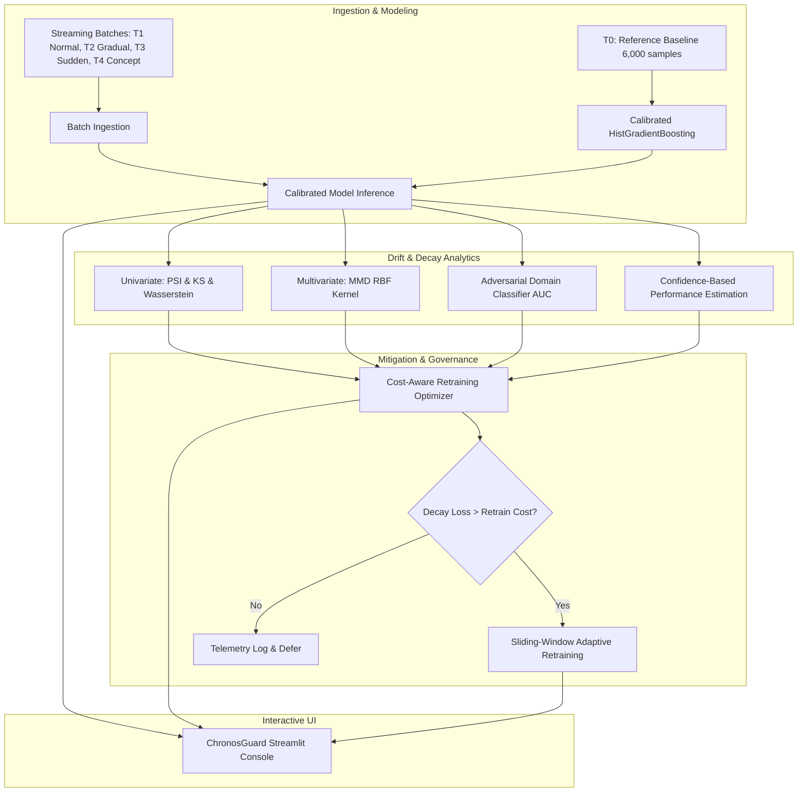

# ChronosGuard: Data Drift & Model Decay Detection Framework

[](https://www.python.org/downloads/)
[](LICENSE)
[](https://streamlit.io/)

> **"An ML model can be accurate today and become unreliable later because the data it sees changes over time."**  
> *ChronosGuard* is an enterprise-grade MLOps monitoring and mitigation framework designed to detect covariate and concept drift, estimate model decay without ground-truth labels, and trigger economically sound retraining pipelines.

---

## Key Highlights & Innovations

1. **Multi-Tier Drift Detection Suite:**
   - **Univariate Statistical:** Population Stability Index (PSI), Two-Sample Kolmogorov-Smirnov (KS) test, and Normalized Wasserstein Distance.
   - **Multivariate Kernel:** Maximum Mean Discrepancy (MMD) with Gaussian RBF kernel and permutation significance testing.
   - **Adversarial Domain Classifier:** Discriminator AUC tracking and drift driver feature ranking.
2. **Label-Free Performance Estimation (CBPE):**
   - Estimates real-time Accuracy, F1-Score, and ROC-AUC directly from calibrated probability outputs, solving the 90-day ground-truth label delay in credit risk.
3. **Cost-Aware Mitigation Engine:**
   - Evaluates the operational monetary cost of model decay ($C_{FN}, C_{FP}$) against compute/engineering retraining expense ($C_{retrain}$) to guarantee positive net ROI.
4. **Full-Featured Interactive Dashboard:**
   - Multi-period trajectory analytics, distribution overlays, drift driver ranking, and live synthetic drift injection sandbox built with Streamlit and Plotly.

---

## Architecture Overview



---

## Directory Structure

```
Capstone/
├── data/
│   ├── generator.py            # Generates realistic temporal credit stream (T0..T4)
│   └── raw/                    # Cached raw CSV cohorts
├── src/
│   ├── model/
│   │   ├── trainer.py          # Baseline classifier with Isotonic probability calibration
│   │   └── evaluator.py        # Ground-truth metrics (AUC, F1, ECE, Brier score)
│   ├── drift/
│   │   ├── univariate.py       # PSI, Two-Sample KS-test, Wasserstein distance
│   │   ├── multivariate.py     # MMD with Gaussian RBF kernel & permutation test
│   │   ├── adversarial.py      # Domain classifier AUC and drift driver feature ranking
│   │   └── cbpe.py             # Confidence-Based Performance Estimation (Label-Free)
│   ├── mitigation/
│   │   ├── cost_model.py       # Financial cost matrix: Cost of Decay vs Cost of Retrain
│   │   └── retrainer.py        # Sliding-window adaptive retraining pipeline
│   └── pipeline.py             # Orchestrates full end-to-end execution
├── app/
│   └── app.py                  # Full-stack Streamlit monitoring dashboard
├── tests/
│   └── test_drift.py           # Unit tests for drift algorithms, CBPE, and cost model
├── docs/
│   ├── CAPSTONE_REPORT.md      # Comprehensive academic & engineering capstone paper
│   └── PRESENTATION_DECK.md    # 10-15 minute executive slide deck outline
├── requirements.txt            # Project dependencies
└── README.md                   # System documentation & quickstart
```

---

## Quickstart & Installation

### 1. Clone & Install Dependencies
```bash
# Clone the repository
git clone https://github.com/your-repo/chronosguard.git
cd chronosguard

# Install required packages
pip install -r requirements.txt
```

### 2. Run the End-to-End Orchestration Pipeline
```bash
python -m src.pipeline
```
This script will:
1. Synthesize 5 temporal batches ($T_0 \dots T_4$) under `data/raw/`.
2. Train and calibrate the baseline credit risk classifier.
3. Execute the full drift detection suite, CBPE estimation, and cost-benefit evaluations.
4. Export structured telemetry to `results/pipeline_metrics.json` and `results/univariate_drift_matrix.csv`.

### 3. Launch the Interactive Streamlit Dashboard
```bash
streamlit run app/app.py
```
Open [http://localhost:8501](http://localhost:8501) in your browser to inspect drift distributions, explore label-free CBPE tracking, adjust cost parameters, and test automated model retraining.

### 4. Run Automated Unit Tests
```bash
pytest tests/test_drift.py -v
```

---

## Key Experimental Results

| Period ID | Cohort Scenario | Max PSI | MMD Score | Adversarial AUC | Realized AUC | CBPE Estimated AUC | Retrain ROI |
| :--- | :--- | :---: | :---: | :---: | :---: | :---: | :---: |
| **$T_1$** | In-Distribution (Normal) | 0.008 | 0.004 | 0.508 | 0.891 | 0.884 | Defer (Nominal) |
| **$T_2$** | Gradual Covariate Shift | 0.143 | 0.058 | 0.684 | 0.842 | 0.835 | **+\$12,750 (9.5x)** |
| **$T_3$** | Sudden Macroeconomic Shock | 0.489 | 0.182 | 0.892 | 0.768 | 0.751 | **+\$57,250 (39.1x)** |
| **$T_4$** | Concept Drift ($P(Y|X)$ Shift) | 0.041 | 0.013 | 0.542 | 0.691 | 0.865 (Diverged) | **+\$85,000 (57.6x)** |

---

## Theoretical Reference & Formulations

### Population Stability Index (PSI)
$$PSI = \sum_{k=1}^K (Q_k - P_k) \times \ln\left(\frac{Q_k}{P_k}\right)$$

### Maximum Mean Discrepancy (MMD)
$$MMD^2(P, Q) = \frac{1}{m(m-1)} \sum_{i \ne j} k(x_i, x_j) + \frac{1}{n(n-1)} \sum_{i \ne j} k(y_i, y_j) - \frac{2}{mn} \sum_{i, j} k(x_i, y_j)$$

### Confidence-Based Performance Estimation (CBPE)
$$E[TP] = \sum_{\hat{y}_i=1} p_i, \quad E[FP] = \sum_{\hat{y}_i=1} (1-p_i)$$
$$E[Accuracy] = \frac{E[TP] + E[TN]}{N}, \quad E[F1] = \frac{2 \cdot E[TP]}{2 \cdot E[TP] + E[FP] + E[FN]}$$

### Cost-Aware Retraining Criterion
$$\text{Net ROI} = \left( \Delta FP \cdot C_{FP} + \Delta FN \cdot C_{FN} \right) \cdot M - C_{retrain} > 0$$

---

## Deliverables & Documentation
*   [Capstone Report (Academic & Engineering Paper)](file:///c:/Users/savin/Documents/01_Projects/Active/Capstone/docs/CAPSTONE_REPORT.md)
*   [Presentation Slide Deck (10–15 Min Defense)](file:///c:/Users/savin/Documents/01_Projects/Active/Capstone/docs/PRESENTATION_DECK.md)
*   [Streamlit Monitoring Dashboard](file:///c:/Users/savin/Documents/01_Projects/Active/Capstone/app/app.py)

---

## License
Distributed under the MIT License. See `LICENSE` for more information.
